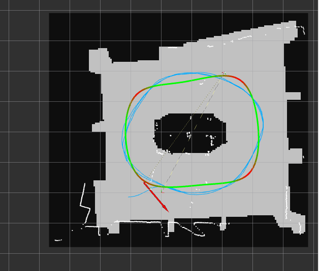

# Q2 RViz / AMCL diagnosis

Updated: 2026-07-22

## RViz result



The blue line is `/car_path`, the green/red line is the optimal racing line, and
the white points are `/scan`. Use the scan-to-map alignment—not the blue line
alone—to decide whether controller tuning results are valid.

## Symptoms

- The blue `/car_path` leaves the green/red racing line by a large distance.
- White `/scan` points do not overlap the map walls and may appear outside the map.
- Q2 falsely detects walls as obstacles, takes unusual avoidance paths, or appears slow.

## Root cause

Do not tune Stanley steering while the LiDAR scan and map are misaligned. Q2 converts
LiDAR detections into `map` coordinates using AMCL. A wrong pose therefore corrupts
both racing-line tracking and obstacle classification.

Use this order:

1. Synchronize the laptop and Jetson clocks.
2. Align the LiDAR and map with RViz `2D Pose Estimate`.
3. Save the verified pose with `./race.sh savepose`.
4. Restart in box mode and confirm that alignment persists.
5. Tune steering or speed only after localization is correct.

## Safe alignment procedure

Start without allowing the wheels to drive:

```bash
cd ~/yax
./race.sh stop
./race.sh box q2
```

In RViz:

1. Set `Fixed Frame` to `map`.
2. Select `2D Pose Estimate`.
3. Click the car's real position and drag in its real forward direction.
4. Repeat until the white LiDAR points overlap the map walls.

Save the aligned pose from another Jetson terminal:

```bash
cd ~/yax
./race.sh savepose
```

Restart and verify that the alignment persists:

```bash
./race.sh stop
ros2 daemon stop
./race.sh box q2
```

Only start `./race.sh q2` when the vehicle marker is on the gray track, its heading
matches the physical car, and the white scan overlaps the inner and outer walls.

## Clock synchronization

Compare epoch time on both machines:

```bash
date +%s
ssh jetson@192.168.45.246 date +%s
```

If they differ substantially, copy the laptop time to the Jetson:

```bash
JETSON_TIME="$(date '+%Y-%m-%d %H:%M:%S')"
ssh -t jetson@192.168.45.246 "sudo date -s '$JETSON_TIME'"
```

Restart ROS processes on both machines after changing the clock so stale TF and
message timestamps are removed.

## Log interpretation

- `Message Filter dropping message` only during startup can occur before TF is ready.
  If it continues while driving, check clock sync and `map -> odom -> base_link -> laser`.
- `rcl_shutdown already called` and `publisher's context is invalid` after Ctrl+C are
  shutdown warnings, not the cause of bad driving.
- Q2 may briefly leave the racing line to avoid a real obstacle. Large deviations in
  obstacle-free sections should be treated as a localization problem first.

## Work completed on 2026-07-21 and 2026-07-22

### ROS 2 networking

- Installed/configured CycloneDDS for more reliable `/map` and `/tf_static` delivery
  over Wi-Fi.
- Configured the driving subnet as `192.168.45.x` and the fixed Jetson peer as
  `192.168.45.246`.
- Added `network.domain_id` handling to `config/dds_env.sh` and set both machines to
  `ROS_DOMAIN_ID=0`.
- Diagnosed an RViz failure caused by a laptop/Jetson clock difference of several
  hours. Old LaserScan timestamps were rejected by the RViz message filter.

Useful verification commands:

```bash
source /opt/ros/humble/setup.bash
source config/dds_env.sh
echo "DOMAIN=${ROS_DOMAIN_ID:-0}"
echo "RMW=${RMW_IMPLEMENTATION:-default}"
echo "CYCLONEDDS_URI=${CYCLONEDDS_URI:-not-set}"
```

### Q2 obstacle avoidance

The first stable obstacle-avoidance update made these changes:

- Compare the available track area on the left and right before selecting an
  avoidance direction.
- Prefer the open track side instead of relying only on obstacle-centroid position.
- Increase lateral avoidance shift from `0.42 m` to `0.48 m`.
- Change obstacle speed multiplier from `0.85` to `0.65`.
- Increase minimum obstacle horizon from `0.8 m` to `1.0 m`.
- Increase speed-dependent horizon time from `0.6 s` to `0.8 s`.
- Increase shift ramp rate from `0.9 m/s` to `1.1 m/s`.

Current principal Q2 values:

```yaml
speed:
  q2_max: 1.5

stanley:
  gain: 1.6
  k: 1.8
  ks: 1.5
  ff_gain: 2.5
  ff_preview_sec: 0.38
  steer_lpf: 1.0
  obstacle_decel: 0.65
  car_width: 0.30
  obstacle_margin: 0.18
  obstacle_shift_rate: 1.1
  obs_horizon_sec: 0.8
  obs_horizon_min: 1.0
  obs_vote_frames: 3
```

### Cornering experiment

A curvature-based speed cap was added so straight-line speed remains `1.5 m/s`
while only high-curvature sections slow down:

```yaml
stanley:
  corner_lat_accel: 1.6
  corner_speed_min: 0.9
```

Approximate commanded caps are `1.50 m/s` on straights, `1.26 m/s` around curvature
`1.0 1/m`, and `1.09 m/s` near the maximum measured curvature `1.35 1/m`.

### Localization and starting pose

The previously stored initial pose `(-1.0848, -0.142, 0.0167)` appeared inside the
central occupied region in RViz and was about `0.74 m` from the nearest waypoint.
The configured starting pose and mission line were moved to the first waypoint:

```yaml
mission:
  start_x: 2.4520
  start_y: 3.7801
  start_radius: 0.5

localization:
  init_x: 2.4520
  init_y: 3.7801
  init_yaw: 2.7677
```

This default is valid only when the physical car is placed at that waypoint and faces
the same direction. Otherwise use `2D Pose Estimate` and `./race.sh savepose`.

### Experiments reverted

The following experiments were tested and then removed because they caused unwanted
slowdowns, unusual paths, or changed the desired behavior:

- Automatic reverse recovery after becoming stuck.
- Permanent Q1/racing-line-only mode.
- Separate high obstacle steering gain and immediate one-frame obstacle voting.
- Reduced Q2 maximum speed of `0.8 m/s`.
- Enabling AEB by default.
- Enabling wall avoidance by default.

The current configuration therefore has both optional layers disabled:

```yaml
safety:
  enabled: false

wall_avoid:
  enabled: false
```

### Deployment workflow

Configuration-only changes require copying `race_script.yaml` and restarting the
stack. Python or launch-file changes also require rebuilding `race_stack`.

```bash
# Laptop
scp race_script.yaml jetson@192.168.45.246:~/yax/
scp src/race_stack/race_stack/stanley_controller.py \
  jetson@192.168.45.246:~/yax/src/race_stack/race_stack/
scp src/race_stack/launch/race.launch.py \
  jetson@192.168.45.246:~/yax/src/race_stack/launch/

# Jetson
cd ~/f1tenth_ws
./race.sh stop
colcon build --packages-select race_stack --symlink-install
source /opt/ros/humble/setup.bash
source ~/f1tenth_ws/install/setup.bash
cd ~/yax
./race.sh q2
```

## Important rule

Never judge controller tuning from an RViz capture where the white LiDAR scan does not
match the map. A controller cannot follow a map-frame racing line from an invalid pose.
