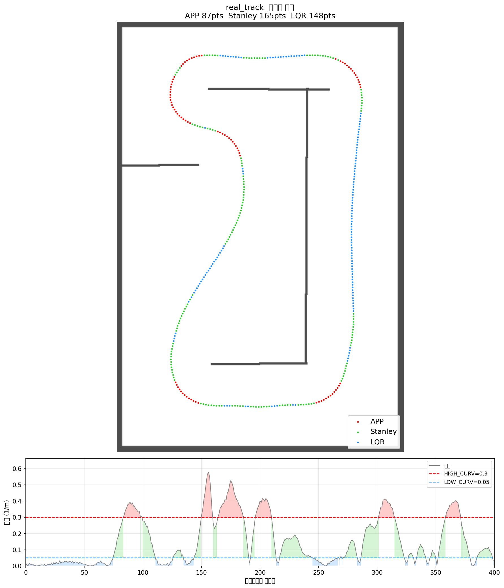

# F1TENTH 자율주행 프로젝트

## 개요
F1TENTH 시뮬레이터 기반 자율주행 프로젝트입니다.  
APP · Stanley · LQR 하이브리드 제어기로 웨이포인트를 추종하며 충돌 없이 완주하는 것을 목표로 합니다.

---

## 환경
- OS: Ubuntu 22.04
- ROS 2: Humble
- Python: 3.10
- 시뮬레이터: f1tenth_gym_ros

---

## 파일 구조

```
~/f1tenth/f1TENTH/
├── sim_ws/                                      # 시뮬레이터 워크스페이스
│   └── src/f1tenth_gym_ros/
│       ├── config/
│       │   └── sim.yaml                         # 시뮬 설정 (맵 경로, 스폰 위치)
│       ├── launch/
│       │   ├── gym_bridge_launch.py             # 시뮬레이터 launch 파일
│       │   └── gym_bridge.rviz                  # RViz 설정
│       └── maps/
│           ├── {맵}.png / {맵}.yaml              # 맵 이미지 + 설정
│           ├── {맵}_waypoints.csv               # 웨이포인트 데이터
│           ├── {맵}_waypoints.jpg               # 웨이포인트 시각화 (속도 컬러맵)
│           ├── {맵}_controller.jpg              # 제어기 분포 시각화 (APP/Stanley/LQR)
│           ├── {맵}_center.jpg                  # 중심선 그래프 시각화
│           ├── {맵}_route{n}.csv                # 루트 경로
│           ├── {맵}_ga_route{n}.csv             # GA 최적화 결과
│           └── {맵}_ga.jpg                      # GA 시각화
│
└── f1tenth_ws/                                  # 드라이버 워크스페이스
    └── src/f1tenth_racing/
        ├── setup.py                             # 패키지 엔트리포인트 등록
        ├── launch/
        │   └── sim_launch.py                    # 드라이버 launch 파일
        └── f1tenth_racing/
            ├── racing_node.py               # ★ 런처 — 실행 시 주행 방식 선택 메뉴
            ├── pure_pursuit_node.py         # 주행 노드: Pure Pursuit + FTG (클래식)
            ├── hybrid_controller_node.py    # 주행 노드: Hybrid (APP + Stanley + LQR + FTG)
            ├── lap_timer_node.py            # 랩타임 측정 + CSV 기록 (controller 컬럼 포함)
            ├── generate_waypoints.py        # 웨이포인트 생성기 (레이싱 라인 최적화)
            ├── generate_waypoints_center.py # 중심선 추출 + 분기점 그래프 시각화
            ├── generate_controller_map.py   # 제어기 분포 이미지 생성 (독립 스크립트)
            ├── ga_racing_line.py            # 유전 알고리즘 레이싱 라인 최적화
            ├── make_waypoints.py            # 웨이포인트 생성 통합 스크립트
            ├── make_yaml.py                 # 맵 yaml 자동 생성
            ├── setup_sim.py                 # 시뮬 설정 스크립트
            └── optimize_pp_params.py        # Pure Pursuit 파라미터 자동 최적화
```

---

## 빌드 명령어

### sim_ws 빌드
```bash
cd ~/f1tenth/f1TENTH/sim_ws
colcon build
source install/setup.bash
```

### f1tenth_ws 빌드
```bash
cd ~/f1tenth/f1TENTH/f1tenth_ws
colcon build
source install/setup.bash
```

### f1tenth_racing 패키지만 빌드 (빠름)
```bash
cd ~/f1tenth/f1TENTH/f1tenth_ws
colcon build --packages-select f1tenth_racing
source install/setup.bash
```

### 심볼릭 링크 빌드 (Python 파일 수정 시 재빌드 불필요)
```bash
cd ~/f1tenth/f1TENTH/f1tenth_ws
colcon build --packages-select f1tenth_racing --symlink-install
source install/setup.bash
```
> `setup_sim.py`로 맵 변경 후 매번 빌드하기 번거로울 때 사용. 한 번만 실행하면 이후엔 노드 재시작만으로 반영됨.

---

## 실행 명령어

### 터미널 1 — 시뮬레이터
```bash
cd ~/f1tenth/f1TENTH/sim_ws
source install/setup.bash
ros2 launch f1tenth_gym_ros gym_bridge_launch.py
```

### 터미널 2 — 드라이버
```bash
cd ~/f1tenth/f1TENTH/f1tenth_ws
source install/setup.bash
ros2 run f1tenth_racing racing_node
```
실행하면 주행 방식 선택 메뉴가 표시됩니다:
```
┌─────────────────────────────────────────┐
│       F1TENTH  주행 방식 선택            │
├─────────────────────────────────────────┤
│  1. Pure Pursuit + FTG  (클래식)         │
│  2. Hybrid  (APP + Stanley + LQR + FTG) │
└─────────────────────────────────────────┘
선택 (1/2):
```

> `ros2 launch` 대신 `ros2 run`을 사용해야 `input()` 프롬프트가 정상 작동합니다.

각 노드를 직접 실행할 수도 있습니다:
```bash
ros2 run f1tenth_racing pure_pursuit_node       # PP + FTG
ros2 run f1tenth_racing hybrid_controller_node  # Hybrid
```

---

## 새로운 맵 설정 순서

### 1. 맵 파일 복사
```bash
cp /path/to/new_map.png ~/f1tenth/f1TENTH/sim_ws/src/f1tenth_gym_ros/maps/
```

### 2. yaml 파일 생성 (없는 경우)
```bash
python3 ~/f1tenth/f1TENTH/f1tenth_ws/src/f1tenth_racing/f1tenth_racing/make_map_yaml.py
```

### 3. 웨이포인트 생성
```bash
python3 ~/f1tenth/f1TENTH/f1tenth_ws/src/f1tenth_racing/f1tenth_racing/make_waypoints.py
```
- 맵 선택 → 스폰 위치 클릭 → 안전 여유 입력 (0.4~0.8m)

### 4. 시뮬 설정 (스폰 위치 · 방향 지정)
```bash
python3 ~/f1tenth/f1TENTH/f1tenth_ws/src/f1tenth_racing/f1tenth_racing/setup_sim.py
```
- 맵 이미지에서 스폰 위치 클릭(1번) → 주행 방향 클릭(2번)

### 5. 빌드 후 실행
```bash
cd ~/f1tenth/f1TENTH/f1tenth_ws
colcon build --packages-select f1tenth_racing
source install/setup.bash
```

---

## 주행 방식 비교

두 컨트롤러를 `racing_node`로 선택 실행하면 `~/f1TENTH/lap_results.csv`에 `controller` 컬럼으로 구분 기록됩니다.

| 컨트롤러 | 파일 | 특징 |
|---|---|---|
| `pure_pursuit` | `pure_pursuit_node.py` | 속도 비례 adaptive lookahead + 전방 감속 |
| `hybrid` | `hybrid_controller_node.py` | APP·Stanley·LQR 곡률 기반 자동 선택 |

> 기존 `lap_results.csv`가 있다면 컬럼 구조가 변경되었으므로 삭제 후 새로 측정하세요.

---

## 하이브리드 제어기 (`hybrid_controller_node.py`)

쿠빅 스플라인으로 사전 계산한 곡률에 따라 매 주기 자동으로 제어기를 선택합니다.

| 구간 | 제어기 | 조건 |
|---|---|---|
| 타이트 코너 | **APP** (Adaptive Pure Pursuit) | 곡률 ≥ 0.3 또는 횡오차 ≥ 0.3m |
| 완만한 커브 | **Stanley** | 0.05 < 곡률 < 0.3 |
| 직선 | **LQR** | 곡률 ≤ 0.05 |



제어기 분포 이미지 생성 (ROS 불필요):
```bash
python3 ~/f1tenth/f1TENTH/f1tenth_ws/src/f1tenth_racing/f1tenth_racing/generate_controller_map.py --map real_track
# 임계값 조정 시
python3 generate_controller_map.py --map real_track --high-curv 0.25 --low-curv 0.06
```

### 주요 파라미터

| 파라미터 | 기본값 | 설명 |
|---|---|---|
| `WHEELBASE` | 0.33 | 차량 축간거리 (m) |
| `SPEED_SCALE` | 1.1057 | 웨이포인트 속도 배율 |
| `LA_BASE` | 0.5931 | APP 전방주시거리 기본값 (m) |
| `LA_K` | 0.1234 | 속도 비례 lookahead 증가율 |
| `LA_K_CURV` | 0.8 | 곡률 비례 lookahead 감소율 |
| `STANLEY_K` | 0.5 | Stanley 횡오차 게인 |
| `LQR_Q1/Q2` | 1.0 / 0.5 | LQR 상태 페널티 (CTE / 헤딩) |
| `A_BRAKE` | 9.4675 | 최대 제동 가속도 (m/s²) |
| `STEER_ALPHA` | 0.40 | 조향 저역통과 필터 |
| `HIGH_CURV` | 0.3 | APP 전환 곡률 임계값 |
| `LOW_CURV` | 0.05 | LQR 전환 곡률 임계값 |

파라미터 자동 최적화:
```bash
python3 ~/f1tenth/f1TENTH/f1tenth_ws/src/f1tenth_racing/f1tenth_racing/optimize_pp_params.py
```

---

## 비상 회피 시스템 (공통)

두 컨트롤러 모두 LiDAR 기반 비상 회피 기능이 내장되어 있습니다.

### 상태 머신

| 상태 | 설명 | 전환 조건 |
|---|---|---|
| `NORMAL` | 주행 | 기본 상태 |
| `REVERSING` | 후진 복구 | 전방 < `COLLISION_THRESH` 감지 시 |
| `FTG` | Follow The Gap 주행 | 전방 < `OBSTACLE_TRIGGER_DIST` 또는 Stuck 감지 |

- REVERSING 완료 후 → 직전 상태(NORMAL 또는 FTG)로 복귀
- FTG 중 전방 > `OBSTACLE_TRIGGER_DIST × 2` 이면 NORMAL 자동 복귀

### 비상 회피 파라미터

| 파라미터 | 기본값 | 설명 |
|---|---|---|
| `WALL_SIDE_THRESH` | 0.5 m | 측면 보정 시작 거리 |
| `WALL_BIAS_GAIN` | 0.4 | 측면 보정 조향 게인 |
| `COLLISION_THRESH` | 0.25 m | 충돌 판정 거리 (전방 ±30°) — 이 거리 미만이면 후진 전환 |
| `BRAKE_START_DIST` | 2.0 m | 비례 제동 시작 거리 (이 거리부터 가까워질수록 속도 감소) |
| `REVERSE_SPEED` | 0.8 m/s | 후진 속도 |
| `REVERSE_DURATION` | 3.5 s | 후진 시간 |
| `STUCK_TIME` | 3.0 s | Stuck 판정 시간 |
| `STUCK_DIST_THRESH` | 0.15 m | Stuck 판정 변위 임계값 |
| `FTG_SPEED_MAX` | 3.0 m/s | FTG 최대 속도 |
| `FTG_GAP_THRESH` | 0.5 m | FTG 갭 인정 최소 거리 |

### 비례 제동 (Proportional Braking)

전방 장애물이 `BRAKE_START_DIST(2.0m)` 이내로 들어오면 거리에 비례해 속도를 줄입니다.  
`COLLISION_THRESH(0.25m)`에 도달하면 속도 0으로 수렴 후 `REVERSING` 상태로 전환합니다.


### 웨이포인트 방향 자동 보정

시작 시 차량 헤딩과 웨이포인트 진행 방향을 비교해 반대이면 자동으로 배열을 역전합니다.  
로그에 `웨이포인트 방향이 차량 헤딩과 반대 → 배열 역전` 메시지가 출력됩니다.

---

## 주행 파일 변경 시 수정해야 할 것들

### 주행 노드를 바꿀 때 (예: `pure_pursuit_node` → `new_driver`)

**1. `setup.py` — 엔트리포인트 등록**
```python
# f1tenth_ws/src/f1tenth_racing/setup.py
'console_scripts': [
    'pure_pursuit_node = f1tenth_racing.pure_pursuit_node:main',
    'new_driver = f1tenth_racing.new_driver:main',  # 추가
],
```

**2. `sim_launch.py` — 실행할 노드 변경**
```python
# f1tenth_ws/src/f1tenth_racing/launch/sim_launch.py
Node(
    package='f1tenth_racing',
    executable='new_driver',
    name='new_driver',
    output='screen',
)
```

**3. `setup_sim.py` — 웨이포인트 경로 자동 업데이트 대상 변경**
```python
PP_NODE = os.path.join(WP_DIR, 'new_driver.py')
```

**4. 빌드**
```bash
cd ~/f1tenth/f1TENTH/f1tenth_ws
colcon build --packages-select f1tenth_racing
source install/setup.bash
```

---

---

## 중심선 그래프 시각화 (`generate_waypoints_center.py`)

맵의 중심선을 추출하고 분기점 구조를 그래프로 시각화하는 도구입니다.  
복잡한 실내 맵(T자 교차로, 다중 복도 등)에서 트랙 토폴로지를 파악하는 데 사용합니다.

```bash
python3 ~/f1tenth/f1TENTH/f1tenth_ws/src/f1tenth_racing/f1tenth_racing/generate_waypoints_center.py
```

**실행 순서:**
1. 맵 선택 (번호 또는 이름)
2. 맵 이미지에서 시작점 클릭(1번) → 주행 방향 클릭(2번)
3. 결과 이미지 `waypoints_{맵이름}_center.jpg` 자동 저장

**출력 내용:**
- 왼쪽: 원본 스켈레톤 (벽거리 RdYlGn 색상)
- 오른쪽: DFS 가지 제거 후 메인 루프 + 분기점 노드(빨간 원) + 시작점(파란 별)
- 터미널: 노드 수, 엣지 수, 각 엣지 길이(m) 출력

---

개발 과정 및 수정 이력은 [개발현황.md](개발현황.md)를 참고하세요.
